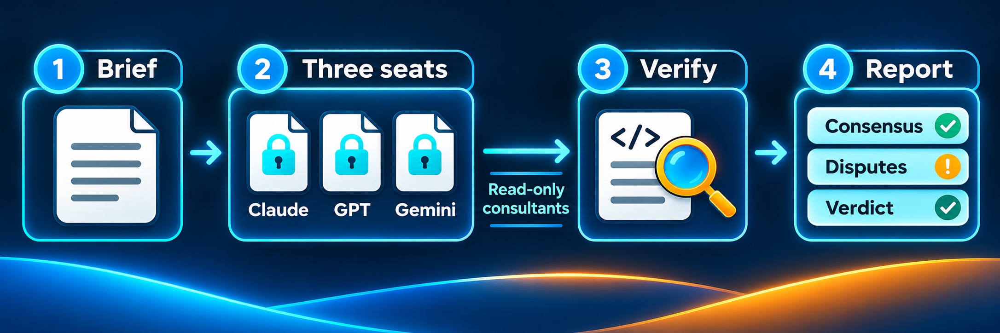

[](https://github.com/OSideMedia/model-council/releases/tag/v1.7.0) [](https://github.com/OSideMedia/model-council/actions/workflows/selftests.yml) [](LICENSE) [](https://claude.com/claude-code) [](docs/MODEL-PLAYBOOK.md) [](commands/council.md)

# Model Council

> One question. Three frontier models from three providers. One judge.


`/council` is a Claude Code slash command that convenes a multi-model review board on
any question worth more than one opinion: an architecture decision, a pre-release audit,
a bug that survived two fix attempts. Your main Claude Code session writes one
self-contained brief, fans it out in parallel to three seats — the **Codex seat
(OpenAI)**, the **Gemini seat (Google, run through the Antigravity CLI)** and the
**Claude seat (Anthropic, pinned to Opus)** — then verifies their claims against the
actual code and delivers a consensus / disputes / verdict report.



The design premise: models from the same provider share blind spots. Seats from
different providers disagree in useful ways — and a council is only as good as the judge, so every seat is a
**read-only consultant** and nothing becomes a "finding" until the overseer has verified
it in the code itself.

## Requirements

- [Claude Code](https://claude.com/claude-code) — runs two different things. The
  **overseer** is your main session, on whichever Claude model it is using; it is the
  judge, not a seat. The **Claude seat** is the `council-seat` agent, pinned to Opus at
  high effort with a declared tool list of Read, Grep and Glob. It needs the agent file
  installed (see Install); without it the seat is empty and the report says so.
- [Codex CLI](https://github.com/openai/codex), **exactly version 0.163.0**
  (`npm i -g @openai/codex@0.163.0`) — the Codex seat. The wrapper refuses to run on any
  other version; see [The Codex seat](#the-codex-seat-what-is-enforced-and-what-is-not).
  Optional; an absent or refused seat is recorded and skipped.
- [Antigravity CLI](https://antigravity.google) (`agy`) — the Gemini seat. Optional; same graceful degradation.
- `bash` for both seat wrappers, and `python3` for the Codex one (`--check` reads the
  models cache with python3); a POSIX `sh` and its standard utilities, with `awk`, `diff`, `iconv`, `locale`, `shasum`
  and `python3`, for the tests (the deny-list's Unicode scan runs in python3), and `git`
  for the release check. All of these ship with macOS and every mainstream Linux, `git`
  with the developer tools.

A council convenes with whatever answers. Missing seats are reported, never silently
papered over.

## Install

```sh
mkdir -p ~/.claude/commands
cp commands/*.md ~/.claude/commands/
cp docs/MODEL-PLAYBOOK.md ~/.claude/
cp scripts/codex-seat.sh ~/.claude/ && chmod +x ~/.claude/codex-seat.sh
cp scripts/agy-seat.sh ~/.claude/ && chmod +x ~/.claude/agy-seat.sh
mkdir -p ~/.claude/agents
cp agents/council-seat.md ~/.claude/agents/
```

The wrapper lines are not optional if you want the Codex and Gemini seats: `/council`
calls `~/.claude/codex-seat.sh` and `~/.claude/agy-seat.sh` for those seats and nothing
else, so without the wrappers in place those seats come back empty every time — reported
as empty, but empty.

The last two lines are not optional if you want the Claude seat. `/council` seats the
agent named `council-seat` and nothing else: if `~/.claude/agents/council-seat.md` is
missing, or its frontmatter is not the restricted definition, the Claude seat is empty,
and the command never puts a general-purpose agent in its place. If a session that was
already running does not list the agent, start a new one. Install the file unchanged.
The command checks the frontmatter line for line before seating it; it does not check
the text below the frontmatter. See
[The Claude seat](#the-claude-seat-what-is-enforced-and-what-is-not).

## Use

In any Claude Code session:

```
/council Is the caching layer in src/cache/ actually safe under concurrent writes?
```

The session writes the brief, seats the council in parallel, verifies the load-bearing
claims, and reports per-seat attribution, consensus, disputes, and a verdict. It does
**not** act on the verdict — fixes are a separate instruction, so you stay in the loop
between judgment and change.

### When to convene (from the playbook)

Worth a council: architecture decisions that are expensive to reverse, pre-release
audits of money-touching code, a bug that survived two fix attempts, "is this design
actually good?" before a big build.

Not worth it: anything one consultant covers — a verification pass (Opus), a second
implementation (Codex), a mechanical sweep (a fast model fanned out). The playbook has
the full routing table.

## Why this shape

Most multi-model setups either let several agents edit the same code (merge chaos) or
average their opinions (confidence laundering). This one is a court, not a committee:

- **Consultants never edit.** The Codex wrapper builds the `codex exec` command itself,
  always with the read-only sandbox, and refuses any argument that could change that.
  Gemini answers from the brief alone with tool permissions denied. The Claude seat is
  an agent whose declared tool list is Read, Grep and Glob — no file-writing tool and no
  shell — and it still carries the read-only guard in its prompt. Read-only is about
  writing: a seat that can read your code sends what it reads to its model provider.
- **Consensus must be verified.** Two seats agreeing raises *priority*, never
  *confidence* — two models can share one wrong reading. A finding is only "consensus"
  after the overseer confirms it in the file. Echo votes from the file-blind seat don't
  count.
- **Degraded runs are named honestly.** If fewer than two consultant seats answer, the
  report says "single-consultant review", not "council".
- **Three things are called a fallback, and they are not the same.** A *model fallback*
  is the Codex seat re-running the same brief on its second model after a spent usage
  window: same seat, same provider, and the wrapper says so. A *fallback read* is the
  playbook's stand-in when a seat is unavailable: a fresh Claude reader does the step
  and the result is labelled as such. It is not that seat, and it is never evidence
  from the provider that did not answer, so it does not count toward the two seats a
  council needs. An *agent fallback* — seating some other agent when `council-seat` is
  missing — is prohibited: that seat is empty.
- **Briefs are evidence-grade.** Excerpts are generated from disk with line numbers,
  and every finding carries a `verified:` field — "read in the file" vs "inferred from
  the brief" — so fabricated citations have nowhere to hide.

These rules aren't theoretical: this command has repeatedly caught one seat confidently
reporting a shell-injection "vulnerability" that an empirical test refuted in one line,
and fabricating file:line citations for files it never saw. The process is built to
absorb that failure mode.

## What's in the box

| File | What it does |
|---|---|
| `commands/council.md` | The `/council` slash command — brief, seats, deliberation, report |
| `commands/audit-claude-md.md` | Bonus: `/audit-claude-md`, a rule-by-rule CLAUDE.md tuner for the judgement-era models (guardrails stay hard, preferences become guidance, procedures move to skills) |
| `docs/MODEL-PLAYBOOK.md` | The routing doc — which model gets which job, how to brief external CLIs, when a council is worth it vs. one consultant |
| `agents/council-seat.md` | The Claude seat's agent definition — Opus at high effort, declared tools Read, Grep and Glob, no memory. Install it unchanged at `~/.claude/agents/` |
| `scripts/codex-seat.sh` | The Codex seat wrapper — the one file that holds the Codex model IDs, with the usage-limit fallback and a `--light` tier. It builds the read-only `codex exec` command itself, accepts a short list of arguments and refuses the rest, and runs on one verified CLI version; `--check` and `--selftest` |
| `scripts/agy-seat.sh` | The Gemini seat wrapper — the one file that holds the Gemini model IDs; starts `agy` in a fresh empty folder so the seat sees only the brief, `--media` for watching and listening; `--check` and `--selftest` |
| `tests/` | The publishing gate: `publicise.sh` (the redacting transform), `check-upstream-sync.sh` (is the published copy still the live one?), `refresh-from-live.sh` (its fixer), `pairs.sh` (the one table of live ↔ published files), `check-release.sh` (every tag's badge names that tag), `selftest-publicise.sh` (proves every refusal goes red, no live source needed), `selftest-council-seat.sh` (runs the command's own shadow search against the published agent and against widened copies of it) |

## Providers, seats and models

Three words that are easy to blur, kept apart here:

- A **provider** is the company whose model answers: OpenAI, Google, Anthropic. The
  command and the playbook also say "vendor"; it means the same thing.
- A **seat** is one consultant's place on the council and the way it is run: a wrapper
  or an agent definition, with that seat's restrictions.
- A **selected model** is the one model a seat is pinned to. Each pin was set together
  with its seat's controls and measured that way. Models from one provider are not
  interchangeable, and nothing here picks a model at run time.

| Provider | Seat | Selected model | Where the pin lives |
|---|---|---|---|
| OpenAI | Codex seat | a primary, and one model fallback used only after a spent usage window | `scripts/codex-seat.sh` |
| Google | Gemini seat | one model for council runs, no fallback | `scripts/agy-seat.sh` |
| Anthropic | Claude seat | Opus at high effort | `agents/council-seat.md` |
| Anthropic | the overseer (not a seat) | whichever model your session is running | your session |

**Requested and observed.** A report names, for each seat, the model that was requested
and the model that answered, and marks the answered model `observed`,
`stated by its CLI`, `pinned` or `unknown`. What stands behind the name differs by seat,
so read it accordingly:

- *Codex seat:* `stated by its CLI`. The Codex CLI prints the model it was run with in
  its own header, before any answer, so the header shows what was selected, not what
  answered. The wrapper prints a line on stderr when it falls back, naming both models.
- *Gemini seat:* `pinned`. The wrapper passes its council model to `agy` and names it
  only when it reports an empty or cut-off answer, so the report repeats the configured
  pin.
- *Claude seat:* `pinned`. The agent definition asks for Opus at high effort; nothing in
  the command reads back which model answered.
- *The overseer:* your session's own model, which the command does not pin, marked
  `stated by the session`. It has a line of its own and is not counted as a seat.

The command's report step asks for this split. `observed` is kept for a model named by a
record of the answer itself, and the report names that record: a configured pin is never
reported as observed, and neither is a model a CLI only states. When no source names the
model, the report says `unknown`, never a guess.

**A refusal is not a fallback.** A line starting `codex-seat: refusing:` or
`agy-seat: refusing:` means the wrapper stopped before any model ran (an argument outside
its list, a CLI version it was not measured on). That seat is empty. A refusal is never
retried on another model, and it is not the same as a seat that ran and answered nothing.

## Model pins

The model slugs live in the two seat wrappers and nowhere else, so a provider's slug
rotation is an edit to one file per seat; this README names none of them. The Claude
seat's pin is the `model:` and `effort:` lines of its agent file. The Codex seat
does not call `codex exec` directly: it goes through `scripts/codex-seat.sh`, which runs
the primary slug and, only when Codex answers *"You've hit your usage limit"*, re-runs
the same brief on the fallback and says so on stderr. `--check` compares every slug against `~/.codex/models_cache.json` (UNKNOWN, not FAIL,
when that cache was fetched by a different client version than your CLI — the server
filters the list per client); `--selftest` proves every branch against a fake `codex`.
The Gemini seat goes through `scripts/agy-seat.sh` the same way: `--check` reads `agy
models`, `--selftest` proves every branch against a fake `agy`.
Councils never install or upgrade tooling themselves — a broken seat is reported with
its fix for *you* to run.

## The Codex seat: what is enforced, and what is not

Since v1.6.0 the wrapper does not pass a caller's arguments on to `codex exec`. It reads
them, refuses anything outside a short list, and builds the command itself.

**Enforced by the wrapper** (each has a case in `--selftest`, which runs against a fake
`codex`):

- Every run gets `--sandbox read-only`, `--ignore-user-config`, the built-in `openai`
  provider, web search disabled, and hooks and plugins disabled, whatever the caller
  passed.
- A caller may add only: `-C DIR`, `--skip-git-repo-check`, `--ephemeral`, `--disable` with
  a known feature name, `--output-schema FILE`, `-o FILE`, a reasoning effort, and the
  flags the wrapper already fixes. Each at most once, as separate words, ending in `-`;
  the brief comes on stdin. The wrapper's header has the exact list.
- Anything else exits 2 before any process starts: a writable sandbox, a
  `--dangerously-bypass` flag, any other `-c` setting (an MCP server, a provider, a
  sandbox mode), `--add-dir`, a profile, a model, a positional prompt, a repeated flag.
- It exits 2 unless `codex --version` answers exactly `codex-cli 0.163.0`.
- A refusal is never retried. The fallback model runs only after Codex itself reports a
  spent usage window, and with the same built command.

**Measured on the real CLI, version 0.163.0 only**, by the author, with a probe that is
not published in this repository: the read-only sandbox holds against a project that asks
for full access; with the user config ignored, an MCP server or provider set in the user
or project Codex config does not load; a user hooks file does not run. You cannot re-run
that measurement from this repo. That is why the version is pinned: a flag that changed
meaning in another version would otherwise fail open and look the same.

**Not claimed:**

- That nothing is disclosed. The seat reads the code you point it at and sends it to
  OpenAI; a read-only sandbox stops writes, not reads.
- System, device-management or cloud-managed Codex policy.
- Which built-in tools the model is offered, or what a command run inside the sandbox
  reads or sends over the network.
- The effect of the web-search setting on the real provider.
- The `CODEX_SEAT_*` and `CODEX_HOME` environment overrides, which are for tests.
- The Gemini and Claude seats. The Gemini seat's limits are the ones stated under "Why
  this shape"; the Claude seat has [its own section](#the-claude-seat-what-is-enforced-and-what-is-not).

**If you are upgrading from v1.5.x:** calls that passed other arguments to the wrapper
now exit 2, and so does every call on a Codex CLI other than 0.163.0. The `/council`
command's own call is unchanged. In a council, a refused seat prints a line starting
`codex-seat: refusing:` that names the cause, and it is recorded as an empty seat. Do not
upgrade the CLI to fix a rejected model: change the model lines in the wrapper instead.

**If the wrapper refuses your CLI version:** install 0.163.0
(`npm i -g @openai/codex@0.163.0`), or take a later release of this repo whose wrapper was
verified on the newer CLI. The wrapper's messages and the `/council` command mention
re-running a probe before the pin changes; that step belongs to the wrapper's source and
cannot be done from this repo. Editing the `VERIFIED_CLI` line yourself turns the gate
off without the measurement behind it.

## The Claude seat: what is enforced, and what is not

The Claude seat used to be an unnamed Opus subagent whose only guard was a sentence in
its prompt. It is now the agent `council-seat`, defined in `agents/council-seat.md`.

**What the definition declares:** `model: opus`, `effort: high`, `tools: Read, Grep,
Glob`, and no `memory` field. The declared list holds no file-writing tool and no shell.
The prompt guard is still sent with every brief.

**Measured by the author.** You cannot re-run these from this repo.

- On Claude Code 2.1.322, in the foreground, with a test agent carrying the same tool
  list on a smaller model: it could read and search; Edit, Write, Bash, NotebookEdit and
  one connected MCP tool were refused as not available. The same agent with Write added
  did write, so the refusal comes from the list. Asking for an agent type that does not
  exist returned an error and started nothing.
- On Claude Code 2.1.323, one background run of this agent file: the recorded request
  went to Opus at high effort, and the tool list sent with it was Read, Grep, Glob and
  one tool the runtime added (`advisor`, below). No shell, no file-writing tool, no MCP
  tool. That run did not try a refused tool, so for the background case the evidence is
  the absence of those tools from the request, not a refused call.

**What the command does before seating it.** `/council` tells the overseer to run a
shadow search first, and to leave the seat empty unless it ends in `CLEAR`. The search
holds the installed file to its exact frontmatter and looks for any other agent file
that could take the seat's name, in `~/.claude/agents/` and in every `.claude/agents/`
folder from the working directory up (and from each added directory the overseer
lists). A project file with the same name replaces the
installed definition without a warning, tools and model included; that is what the
search is for. `tests/selftest-council-seat.sh` runs that same block in CI against the
published agent, a missing agent, eight widened or reworded copies and a project shadow.

**Not claimed:**

- That nothing is disclosed. The seat reads whatever your session can read and sends it
  to Anthropic. A tool list without a write tool stops writes, not reads.
- That the shadow search is a security boundary. It is an instruction the overseer
  carries out. Nothing stops a session from skipping it or naming another agent.
- Definitions that outrank the installed one. An agent passed with `--agents`, or set by
  managed settings, takes precedence and is not searched.
- The tools the harness adds on its own. In the one background test of this seat (Claude
  Code 2.1.323) the runtime added a provider-side `advisor` tool to the seat's list. It
  was not invoked; what it does and costs when invoked is unverified. The added tools
  are not guaranteed to stay the same across versions.
- The tools the search itself relies on. It trusts `find`, `awk`, `tr`, `cmp`, `ls` and
  `sh` as your PATH finds them: one that is missing or fails is caught, one that
  misreports is not.
- Any Claude Code version other than the two above, the interactive foreground case on
  the real agent, and which model answers in your own councils (see "Requested and
  observed").

The seat has no git and no shell. A brief that needs that output carries it inline;
Bash is not put back.

**If you are upgrading from v1.6.0 or earlier:** copy `agents/council-seat.md` to
`~/.claude/agents/` along with the new `commands/council.md`.
With the new command and no agent file, the Claude seat is empty on every council — it
is reported, and the Codex and Gemini seats are unaffected, but a council then has at
most two consultants. The Codex and Gemini wrappers are unchanged.

## Staying current

The commands here are a published copy of ones that run live at `~/.claude` on the
author's machine, and a published copy rots quietly: between v1.0.0 and v1.1.0 the live
`/council` gained the falsification gate, the `AUDIT-PRECEDENTS` fold-in, two
sovereignty rules and per-finding dispositions, and this repo shipped none of them for
four weeks without a word. A tool that teaches an older, weaker process is worse than
one that is visibly old.

So the pair is now checked rather than remembered:

```sh
sh tests/check-upstream-sync.sh      # ok / STALE / REFUSED / UNKNOWN per file — see below
sh tests/refresh-from-live.sh        # regenerates from live, then review git diff
sh tests/selftest-publicise.sh       # proves every refusal goes red; needs no live source
sh tests/selftest-council-seat.sh    # the published Claude seat keeps its restricted definition
sh tests/check-release.sh            # every tag's README badge names that tag
```

The first two run the same `tests/publicise.sh` transform over the same table of files
(`tests/pairs.sh`), so "the check is green" and "running the fixer changes nothing" are
the same statement and the two cannot drift apart. That transform is the *only*
sanctioned difference between live and published, and it does two jobs. It **redacts**
the handful of spots that are true on one machine and misleading in public — a fold-in
of local review-dimension files (seats cannot read your disk, and a public command
should not tell them to try), a routing line pointing at a private source repo, two
parentheticals asserting which CLIs are installed, and a few machine-state claims (a
hook that is wired in, a plugin that is installed, a dated private audit) rewritten as
what a stranger's machine can actually do, plus the author's name, private agent and
project names, private file paths, figures and dates read off the author's own usage meters and logs, and the ids of private work-ledger items cited in comments. And it **refuses**: every redaction asserts
the live wording it is anchored to — both ends of a block, not only the line that opens
it — a ledger id left in a shape the strip does not handle stops the file, an output that
is not valid UTF-8 stops it, and every output is scanned against a deny-list of tokens
that must never ship. A token hits in any capitals, in any Unicode spelling of the same
letters, with accents and other marks added or left off, and with zero-width or other
format characters put between its letters. That is deliberately broad: a token `résumé`
also stops a file that says `resume`. The scan only decides; it never rewrites the text.
It is not complete, and a clean scan is not proof that nothing private is in the file. It
does not see a look-alike letter from another script (or a Turkish dotless `ı` for `i`),
a token broken by a space,
punctuation or a line break, an invisible character Unicode does not class as a mark or
a format character, or text in another encoding such as base64. A character newer than
python3's Unicode tables stops the file rather than going unread.

The refusal is the load-bearing half. An unguarded transform anchored on live wording
silently does nothing the moment that wording is reworded — it exits 0 and emits the
un-redacted text, the sync gate reports STALE, and the fix it prescribes then *publishes*
that text and goes green. A guard whose repair step launders the leak is worse than no
guard, so a failed assertion aborts the refresh with every published file untouched, and
`tests/selftest-publicise.sh` proves it by moving each anchor and watching the refusal.

The gate reports a refusal as its own verdict. `REFUSED <file>` carries the transform's
message as written at the refusal site, which names the cause and the next step (re-anchor
a rule, re-encode a byte, add a redaction rule, install a deny-list when there is none).
The gate adds one thing that holds for every refusal: never refresh, which would publish
exactly what was refused. `STALE` is the ordinary case, where the fixer is
the right answer. A file this repo does not publish is refused rather than passed through
ruleless (`--no-rules` is the explicit override), and a live source that is missing on
this machine is `UNKNOWN` with exit 2 whether one file is missing or all of them — never
a pass.

One property of the block rules to keep in mind when reading a refresh diff: a rule
replaces everything from its opening anchor through its terminating one. Live prose
inserted *between* the two — a sentence added inside a paragraph the rule redacts — is
dropped from the published copy along with the lines around it, with no refusal, and
shows up only as `STALE` at the next gate run. That is by design (the paragraph is being
replaced, not edited), but it means the refresh diff is where a live edit that should
have landed outside the block, or become a rule of its own, gets caught. Read it.

The deny-list itself is machine-local, and that is the point: a list of private strings
committed to a public repo publishes the exact strings it exists to withhold. The repo
ships only the format —

```sh
cp tests/publicise-deny.example ~/.claude/publicise-deny.txt   # then fill in your own
```

— and the transform refuses to run without one, or with one that has no usable tokens
in it, rather than deciding a file is safe to publish while having no idea what private
means here.

## Contributing

Issues welcome. One structural thing to know before opening a PR: `commands/*.md`,
`agents/council-seat.md`, `docs/MODEL-PLAYBOOK.md`, `scripts/codex-seat.sh` and
`scripts/agy-seat.sh` are **generated**. They are a
redacted copy of files that run live at `~/.claude` on the author's machine, and the next
`tests/refresh-from-live.sh` overwrites them wholesale — so a PR editing those files
cannot be merged as-is even when it is right, and merging it would only mean losing your
change at the next release.

Open an issue instead: the fix goes in upstream and flows back down here. PRs against
`README.md`, `tests/`, or anything else in the tree are ordinary PRs.

## License

[MIT](LICENSE)
